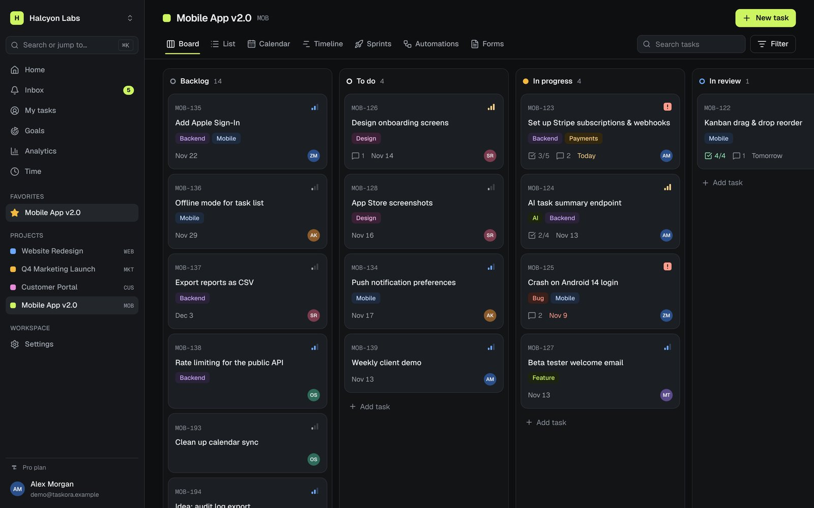
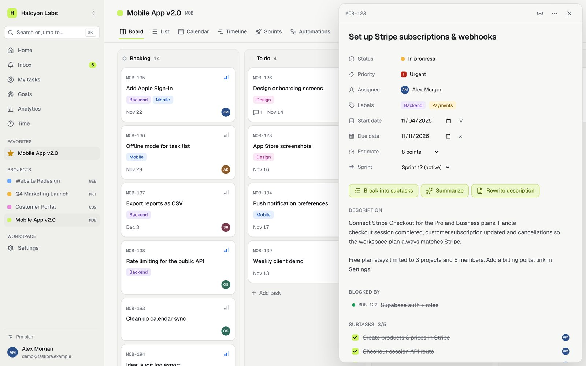
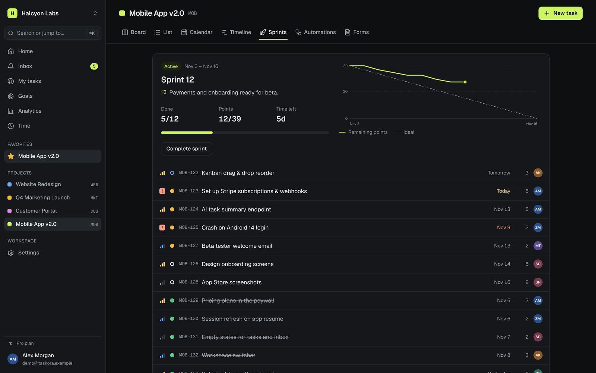
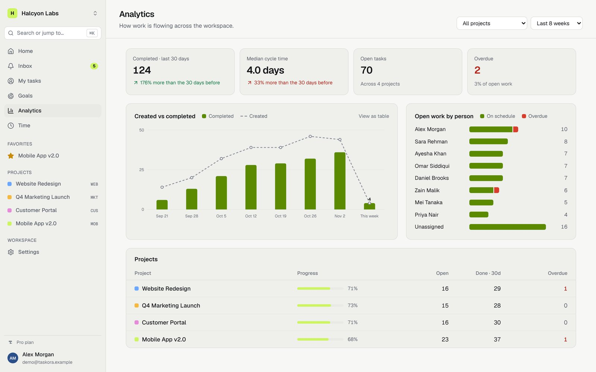
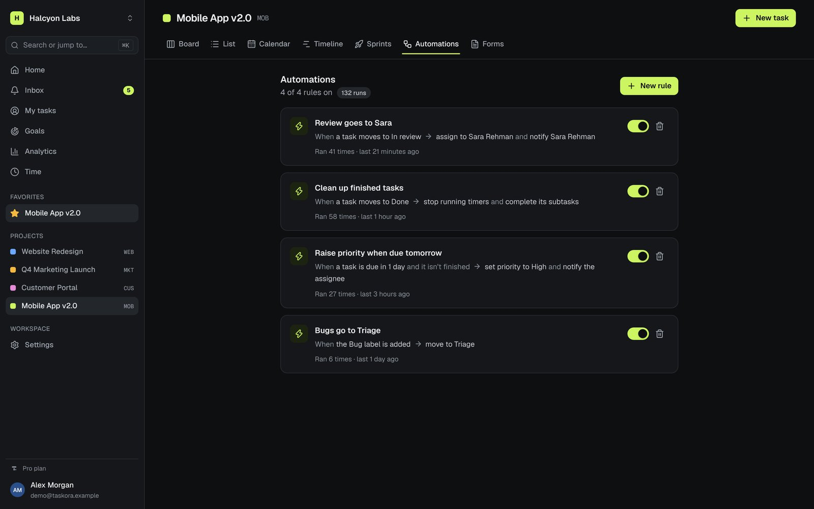

# Taskora

A project management SaaS for product teams: Kanban boards, list, calendar and timeline views, sprints with
burndown, automation rules, public request forms, goals, analytics, time tracking, billing and an AI assistant.

**Live demo:** [taskora-ivory.vercel.app](https://taskora-ivory.vercel.app) — click **Try the live demo**. No
sign-up; the demo workspace rebuilds itself every night.



|                                                      |                                                            |
| ---------------------------------------------------- | ---------------------------------------------------------- |
|  |  |
|    |  |

**Stack:** Next.js 16 (App Router) · React 19 · TypeScript · Tailwind CSS 4 · Supabase (PostgreSQL, Auth,
row level security) · dnd-kit · Stripe (optional) · OpenAI (optional) · Vitest · GitHub Actions · Vercel

## Highlights

- **Security in the database.** Row level security on all 29 tables, column-level grants for billing fields,
  and plan limits enforced by triggers. 31 database tests run against real Postgres in CI.
- **Automations run inside Postgres.** Rules fire from triggers the moment a task changes, with a guard that
  stops one rule from setting off another in a loop.
- **Fast interactions.** Optimistic updates everywhere, a task panel that opens instantly, and reads that
  don't wait in the server-action queue.
- **Honest demo modes.** Without API keys, AI answers and payments run in clearly labelled demo modes. Add a
  Stripe test key or an OpenAI key and the same buttons use the real services.
- **Works on phones.** Press and hold to drag cards, a drawer sidebar, and a calendar that becomes an agenda.
- **Dark and light themes**, keyboard support for drag and drop, and visible focus states throughout.

See [docs/architecture.md](docs/architecture.md) for how it all fits together.

## What's inside

| Area                                                           | Where                                                                |
| -------------------------------------------------------------- | -------------------------------------------------------------------- |
| Design system (tokens, dark/light themes, components)          | `src/app/globals.css`, `src/components/ui`, preview at `/styleguide` |
| Database schema, security policies, RPCs, automation engine    | `supabase/migrations`                                                |
| Project views (board, list, calendar, timeline) and task panel | `src/components/project`                                             |
| AI assistant (demo and live modes)                             | `src/lib/ai`                                                         |
| Analytics calculations (unit tested)                           | `src/lib/analytics`                                                  |
| Billing (demo checkout, Stripe Checkout and webhook)           | `src/lib/billing`, `src/app/api/stripe`                              |
| Demo workspace that rebuilds itself every night                | `supabase/migrations/*_demo.sql`, `src/app/api/cron`                 |
| Database tests (run against real Postgres)                     | `scripts/db-test.ts`                                                 |

## Run it locally

```bash
npm install
cp .env.example .env.local   # fill in your Supabase keys
npm run dev                  # http://localhost:3000
```

### Checks

```bash
npm run lint
npm run typecheck
npm test            # unit tests
npm run db:start    # local Postgres for the database tests (needs PostgreSQL 16 installed)
npm run db:test     # applies every migration and tests security rules, limits, RPCs and automations
```

CI runs all of these on every push (`.github/workflows/ci.yml`).

## Set up Supabase

1. Create a free project at [supabase.com](https://supabase.com).
2. Open **SQL Editor** and run the files in `supabase/migrations` in order.
3. In **Authentication → URL Configuration**, set the Site URL to your deployed URL and add
   `https://your-app.vercel.app/**` and `http://localhost:3000/**` as redirect URLs.
4. Copy the Project URL, anon key and service role key into `.env.local` (and into Vercel).
5. Create the demo account and data: `npm run demo:setup`. The demo account has no password; the
   "Try the demo" button signs visitors in on the server.

Optional: add `STRIPE_SECRET_KEY` and `STRIPE_WEBHOOK_SECRET` (test mode) for real checkout, and
`OPENAI_API_KEY` for live AI answers.
